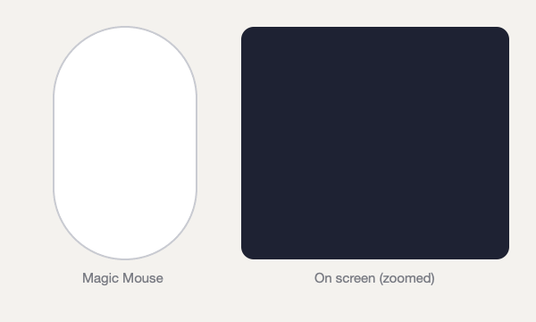

# Jitouch FingerDraw

Draw letters with your fingertip on the top of an Apple Magic Mouse, and each letter runs an action: open an app, open a link or file, press a keyboard shortcut. Out of the box, **F** opens Finder and **B** opens your browser. You can map any letter.



*A real fingertip F recorded from the Magic Mouse's touch sensor and replayed. The right panel is zoomed.*

It's a fork of [Jitouch](https://github.com/JitouchApp/Jitouch). Jitouch already recognizes letters on the Magic Mouse, but you draw them by moving the whole mouse. FingerDraw reads your fingertip on the mouse's touch surface instead.

## What it adds to Jitouch

- **Fingertip drawing on the Magic Mouse surface.** Tap once, put your finger back down, draw, lift.
- **Letters with several strokes,** written the normal way, such as F as a stem plus two bars. Built in: A B D E F H K P R T X. Any other multi-stroke letter works once you train it.
- **Learns your handwriting** (optional). Record each letter a few times, and recognition is matched to how you write.
- **Doesn't fire while you scroll or click.** A click and a scroll flick both start with a touch, so these are ignored: taps that click the button, touches during scrolling, single straight or back-and-forth strokes, and runs of parallel flicks.
- **On-screen ink** in the mouse's real proportions, with a ring showing where your finger is.
- **A log** of every gesture, fired or ignored, with the reason: `~/Library/Logs/Jitouch-gestures.log`.

## How to draw

1. **Tap** the top of the mouse once, lightly. A tap that clicks the button doesn't count.
2. Within about a second, **put your finger back down and draw** the letter.
3. For letters with more than one stroke, **lift and keep going**. The letter is read half a second after your last stroke.

Single straight or back-and-forth strokes (up, down, left, right, diagonal) are ignored on the mouse, because they look exactly like scrolling.

## Install

### Download (easiest)

1. Download `Jitouch-FingerDraw-<version>.pkg` from [Releases](https://github.com/emartin-coder/jitouch-fingerdraw/releases). Apple silicon Macs only.
2. Open it. The installer isn't signed with an Apple Developer ID yet, so macOS blocks it the first time. Go to System Settings > Privacy & Security, click **Open Anyway** next to the blocked installer (it's offered for about an hour), and enter your password ([Apple's steps](https://support.apple.com/guide/mac-help/open-a-mac-app-from-an-unknown-developer-mh40616/mac)).
3. The installer puts the Jitouch settings panel in `/Library/PreferencePanes`. Open it by double-clicking `/Library/PreferencePanes/Jitouch.prefPane` in Finder (Go > Go to Folder). Opening it starts Jitouch and sets it to start at login.
4. Allow Jitouch under System Settings > Privacy & Security > Accessibility. Then, in the panel's **Characters** tab, under "Enable Character Recognition for", tick **Mouse** and map letters to actions.

To uninstall, delete `/Library/PreferencePanes/Jitouch.prefPane` and `~/Library/LaunchAgents/com.jitouch.Jitouch.plist`.

### Build from source

Requirements: a Mac with Apple silicon, a Magic Mouse, and the Xcode Command Line Tools (`xcode-select --install`). Full Xcode isn't needed. Tested only on macOS 26.5.

```sh
git clone <this repo> && cd <repo>
./build.sh            # downloads the official Jitouch 2.82.1 bundle, runs the tests, builds, installs
```

This installs `/Applications/Jitouch.app` and, if you don't already have it, the Jitouch settings panel in `~/Library/PreferencePanes`. Then:

1. Allow Jitouch under System Settings > Privacy & Security > Accessibility.
2. Open the settings (menu bar icon > Open Preferences...). On the **Characters** tab, under "Enable Character Recognition for", tick **Mouse** (it's off by default), then map letters to actions. Opening the settings also sets Jitouch to start at login.

**Each rebuild resets the Accessibility permission,** because the app is signed only for your Mac. To avoid that, run `./make-signing-identity.sh` once. It creates a local code-signing certificate that `build.sh` uses automatically. Allow Accessibility once more after the first build that uses it.

## Teach it your handwriting (optional)

```sh
tools/train.sh G M Y      # spoken cues: draw each letter 8 times, pause about 2 s between letters, don't tap
```

Your examples are saved to `~/Library/Application Support/Jitouch/letters.txt`, and restarting Jitouch loads them. On your next build, `tests/run.sh` checks that each example is recognized using your other examples.

## Limitations

- **Private Apple framework.** Touch data comes from Apple's private MultitouchSupport framework, so a macOS update can break it, and it can't be distributed through the Mac App Store.
- **Apple silicon only, and not notarized.** You build it yourself.
- **Tuned on one person.** The timing and matching cutoffs come from one person's hand and one mouse. The scroll check in `tests/run.sh` only has data if you record your own scrolling into `tests/fixtures/negatives/` (`mkdir -p tests/fixtures/negatives && build/touch_probe 120 > tests/fixtures/negatives/my-scrolling.log`). If something misfires, the gesture log says why.
- **Old settings panel.** It's the original Jitouch one. The fingertip mode has no settings of its own; its tuning values are constants in `jitouch/Jitouch/Gesture.m`.

## Privacy

Recognition, training and logs stay on your Mac. The app's source makes no network requests of its own. Only actions you configure, such as opening a website, use the network. `build.sh` downloads the official Jitouch release once, from GitHub.

## Development

| Command | What it does |
|---|---|
| `tests/run.sh` | Recognizer tests (synthetic touch input), plus checks on your trained letters |
| `build/touch_probe 30 > rec.log` | Records raw Magic Mouse touches for 30 s |
| `tests/replay.sh rec.log` | Replays a recording through the recognizer, with a step-by-step trace |
| `./build.sh --no-install` | Tests and builds into `build/` without installing |
| `swift support/make_demo_gif.swift rec.log docs/demo.gif F "opens Finder"` | Renders the README demo from a recording |
| `tools/make-release.sh 0.1.0` | Builds the installer package into `build/release/` |

## Credits and license

GPL-3.0, like Jitouch. See [LICENSE](LICENSE) and [NOTICE](NOTICE).

- Jitouch: copyright Supasorn Suwajanakorn and Sukolsak Sakshuwong. Modified work copyright Aaron Kollasch.
- Multi-stroke recognition implements the $P point-cloud recognizer described by Vatavu, Anthony and Wobbrock (ICMI 2012).
- FingerDraw changes: copyright 2026 emartin-coder.
